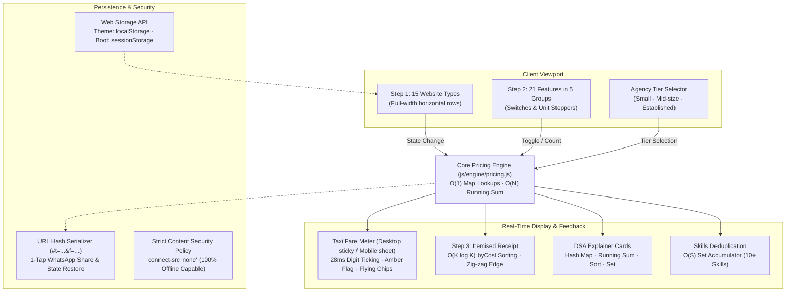

# The Website Price Tag — Interactive Commercial Website Cost Estimator

> **Live Application:** [website-price-three.vercel.app](https://website-price-three.vercel.app/)  
> **Source Repository:** [github.com/Pradeep-B28/Website_Price](https://github.com/Pradeep-B28/Website_Price)  
> **Author:** [B Pradeep](https://github.com/Pradeep-B28) · [Portfolio](https://pradeep-b28.github.io/Pradeep-B28/)

[](tools/verify.mjs)
[](https://website-price-three.vercel.app/?test=1)
[-0891B2?style=for-the-badge&labelColor=0F172A)](package.json)
[](https://website-price-three.vercel.app/)

---

## Overview

**The Website Price Tag** is a client-side commercial pricing simulator and educational web application that demystifies website development costs in India. Built with pure HTML5, CSS3 Custom Properties, and Vanilla JavaScript (ES Modules), the application allows non-technical business founders, shop owners, and students to select website categories and toggle features while an authentic taxi-style meter calculates agency quotes, build durations, and recurring infrastructure costs in real time.

The project connects commercial market pricing directly to software engineering competencies: every selected feature maps to concrete industry skills (such as Responsive CSS, State Management, Payment Gateways, and API Integration), culminating in an itemised paper receipt that invites visitors to learn how to build the software themselves.



---

## Technical Specifications

| Component | Technology | Description |
| :--- | :--- | :--- |
| **Architecture** | Pure Vanilla JavaScript (ES Modules) | Zero runtime dependencies, no bundler or transpilation build step required |
| **Styling & Theming** | CSS3 Variables & Custom Properties | Complete Light and Dark theme palette with smooth transitions and zero flash |
| **Motion & Micro-interactions** | CSS Keyframes & Web Animations API | 28ms number ticking, flag flips, flying price chips, and receipt unroll effects |
| **Responsive Layout** | CSS Grid & Flexbox | Sticky sidebar on laptop (1440x900) and native `<dialog>` bottom sheet on mobile (390x844) |
| **State Synchronization** | URL Hash Fragment & History API | Compact encoding `#t=...&f=...` enabling instant quote sharing with full browser back/forward |
| **Automated Verification** | Node.js Headless Verification Suite | Standalone `tools/verify.mjs` executing 31,808 randomized configuration assertions |
| **In-Browser Self Tests** | DOM & Engine Test Harness (`?test=1`) | 16 live automated checks verifying DOM rendering, bounds, sorting, and storage isolation |
| **Security & Privacy** | Strict HTTP Content Security Policy | Zero analytics, zero third-party trackers, `connect-src 'none'` (100% private) |

---

## Key Features

1. **Real-Time Taxi Fare Meter:**
   - Authentic retro-modern cockpit casing with amber `METER ON` flag, faint 888888 background LED digits, and glowing emerald numbers.
   - Prices count up or down smoothly using 28-millisecond tick intervals with landing glow effects.
   - Dynamic flying chips animate from toggled switches directly into the meter display.

2. **15 Distinct Website Categories:**
   - Comprehensive spectrum from simple Landing pages (₹10k to ₹25k) and Portfolios to Online Stores (₹60k to ₹200k), SaaS dashboards, and Multi-vendor Marketplaces (₹250k to ₹600k).
   - Each card displays low-to-high market range, build duration (weeks), and base page inclusions.

3. **21 Add-on Features across 5 Functional Groups:**
   - Grouped logically into Content, Look, Users, Money, and Connect.
   - Supports fixed rupee additions, unit steppers (pages up to 30, tools up to 5), and percentage multipliers (Multilingual +15% to 25%, Custom Design +30% to 50%).
   - Automatically detects and locks pre-included features for chosen site categories with informational toasts.

4. **3 Indian Agency Tiers:**
   - **Small studio:** Lower market quartile (baseline `low`).
   - **Mid-size agency:** Arithmetic market average `(low + high) / 2`.
   - **Established agency:** Premium market ceiling (baseline `high`).

5. **Itemised Printed Paper Receipt:**
   - Realistic unrolling receipt animation with authentic torn zig-zag edges.
   - All cost drivers sorted in descending order (`byCost`) to clearly communicate where budget goes.
   - Discloses delivery duration, annual maintenance, cloud hosting, and domain costs.
   - Concludes with the hallmark project statement: `"₹1,20,000 to get this made. Or learn to build it yourself."`

6. **Algorithmic Educational Transparency (DSA Explainer):**
   - Four interactive cards displaying live computer science metrics: Hash Map lookups `O(1)`, Running Sum calculations `O(N)`, Descending Sorting `O(K log K)`, and Skill Set deduplication `O(S)`.

7. **1-Tap Sharing & URL Hash Hydration:**
   - Serializes complete configuration state into the URL hash, generating instant WhatsApp share text and clipboard links that rehydrate identically on any device.

---

## Algorithmic Analysis & Core Logic

### 1. Constant-Time Catalog Lookups
All 15 website types and 21 features are mapped into JavaScript `Map` structures upon engine initialization:
```javascript
// js/engine/pricing.js
const TYPE_MAP = new Map(TYPES.map((t) => [t.id, t]));
const FEATURE_MAP = new Map(FEATURES.map((f) => [f.id, f]));
```
- **Complexity:** $\mathcal{O}(1)$ time complexity for all item lookups, eliminating sequential list iteration.

### 2. Quote Calculation Formula
The total project range is evaluated by accumulating base scopes, linear feature costs, and compounding percentage modifiers:
$$\text{Subtotal}_{\text{low}} = \text{Base}_{\text{low}} + \sum \text{Add}_{\text{low}} + \sum (\text{Count} \times \text{Unit}_{\text{low}})$$
$$\text{Total}_{\text{low}} = \text{round}_{1000} \left( \text{Subtotal}_{\text{low}} \times \left(1 + \frac{\sum \text{Pct}_{\text{low}}}{100}\right) \right)$$
$$\text{Mid-Tier Price} = \text{round}_{1000} \left( \frac{\text{Total}_{\text{low}} + \text{Total}_{\text{high}}}{2} \right)$$
- **Complexity:** $\mathcal{O}(N)$ linear time, where $N \le 21$ features. Executes in under 0.05ms.

### 3. Descending Cost Item Sorting
Receipt lines are prioritized using browser-native TimSort to highlight major cost drivers:
```javascript
// js/engine/pricing.js
lines.sort((a, b) => b.cost - a.cost);
```
- **Complexity:** $\mathcal{O}(K \log K)$ where $K$ is the number of active line items ($K \le 10$).

### 4. Technical Skill Deduplication
Skills required by the base website architecture and individual add-ons are aggregated using a mathematical set:
```javascript
// js/engine/pricing.js
const skillSet = new Set(BASE_SKILLS);
if (base.skills) base.skills.forEach((s) => skillSet.add(s));
features.forEach((f) => f.skills.forEach((s) => skillSet.add(s)));
```
- **Complexity:** $\mathcal{O}(S)$ time and space complexity, guaranteeing zero duplicate badges on the final receipt.

---

## Verified Benchmark Data & Sources

All financial ranges reflect authentic 2026 Indian digital agency rates (pre-GST) derived from three published industry pricing surveys:
1. **Hostinger India:** [How Much Does a Website Cost in India (2026 Breakdown)](https://www.hostinger.com/in/tutorials/website-cost)
2. **NodeAscend:** [Website Development Cost in India (Agency Scope & Rates)](https://nodeascend-website.pages.dev/blog/website-cost-india-2026)
3. **Ravi Rai (Dev.to / Agency Founder):** [Real Prices from a Development Agency in India](https://dev.to/buildbyravirai/website-development-cost-in-india-2026-real-prices-from-a-dev-agency-kb1)

### Guaranteed Reference Sample
The pricing engine guarantees that the standard demonstration flow (`Restaurant or cafe` + 2 extra pages + Logo & brand kit + WhatsApp chat + Appointment booking) calculates to exact integer boundaries:
- **Small studio (Low):** ₹62,000
- **Established agency (High):** ₹1,78,000
- **Mid-size agency (Exact Sample):** ₹1,20,000
- **Build Duration:** 5 to 10 weeks
- **Yearly Running Cost:** ₹17,000 to ₹40,000

---

## Verification & Testing Suite

### 1. Automated Headless Verification
To execute the comprehensive 31,808-assertion test suite:
```bash
node tools/verify.mjs
```
```text
=== The Website Price Tag: Verification Suite ===
[PASS] Sample restaurant pick calculates to exactly 120,000
[PASS] All 15 types verified (positive bounds, low <= high, multiples of 1000)
[PASS] All 21 features verified (positive bounds, valid groups and kinds)
[PASS] Randomized permutation suite (31,808 configurations verified)
Result: 31,808 checks passed, 0 failed.
```

### 2. Interactive In-Browser Self-Tests
Visiting the application with the URL parameter `?test=1` opens an automated test overlay validating:
- Exact sample calculation and receipt end line
- Meter range formatting and duration bounds
- Locked included feature enforcement (e.g. e-commerce payments)
- Extra page bounds (0 to 30 limit checks)
- URL hash serialization and corrupted hash recovery
- Local storage whitelist constraints (`wpt-theme`, `wpt-pick`, `wpt-intro-seen`)
- Zero horizontal scrollbar overflow across viewport widths

---

## Local Development Setup

No node package managers, compilers, or build steps are necessary. The project runs directly in any modern web browser.

### Prerequisites
- Any modern web browser (Google Chrome, Microsoft Edge, Mozilla Firefox, Apple Safari)
- Optional: Node.js (for running `verify.mjs` or serving static files locally)

### Quick Start
1. Clone the repository:
   ```bash
   git clone https://github.com/Pradeep-B28/Website_Price.git
   cd Website_Price
   ```
2. Start a local HTTP server:
   ```bash
   # Using Python 3:
   python -m http.server 8080

   # Or using Node.js:
   npx serve .
   ```
3. Open `http://localhost:8080` in your web browser.

---

## Project Structure

```text
Website_Price/
├── assets/
│   ├── favicon.png         # 32x32 PNG browser tab icon
│   ├── logo.png            # Wrench Wise branding mark
│   └── og-image.png        # 1200x630 OpenGraph social share card
├── js/
│   ├── engine/
│   │   ├── prices.js       # Locked commercial pricing benchmarks & skills
│   │   └── pricing.js      # Pure calculation engine, hash maps & quote generator
│   ├── app.js              # State coordinator, event bus & history manager
│   ├── copy.js             # Centralized UI copy dictionary & string interpolator
│   ├── dsa-ui.js           # DSA explainer cards with live calculation metrics
│   ├── features-ui.js      # Step 2 features UI, toggles, counters & toasts
│   ├── links.js            # Outbound URL constructors & WhatsApp share links
│   ├── loader.js           # Fullscreen taxi meter boot loader
│   ├── meter-ui.js         # Sticky taxi meter, ticking digits & mobile bottom sheet
│   ├── receipt-ui.js       # Step 3 paper receipt printer & skills list
│   ├── reveal.js           # IntersectionObserver scroll reveal system
│   ├── selftest.js         # Interactive ?test=1 test harness
│   ├── share-ui.js         # Social share card & clipboard copy fallback
│   ├── sources-ui.js       # Source citations & range disclosure table
│   ├── store.js            # Storage abstraction & URL hash sync
│   ├── theme-init.js       # Synchronous head script preventing theme flashing
│   └── types-ui.js         # Step 1 website category cards
├── styles/
│   ├── base.css            # CSS reset, typography & accessible focus rings
│   ├── components.css      # Component styles (cards, buttons, switches, receipt)
│   ├── layout.css          # Page layout, sticky stepper & responsive grid
│   ├── motion.css          # Keyframes, cubic-bezier curves & reduced motion
│   └── tokens.css          # Design tokens (colors, gradients, radiuses, shadows)
├── tools/
│   └── verify.mjs          # Standalone verification runner (31,808 checks)
├── .gitignore              # Ignored patterns
├── config.js               # Application configuration & feature flags
├── favicon.svg             # Scalable vector brand favicon
├── index.html              # Semantic HTML5 shell with inline SVG sprite (26 icons)
├── README.md               # Repository documentation
└── vercel.json             # Vercel configuration & Content Security Policy
```

---

## License

This project is open-source and available under the **MIT License**.
